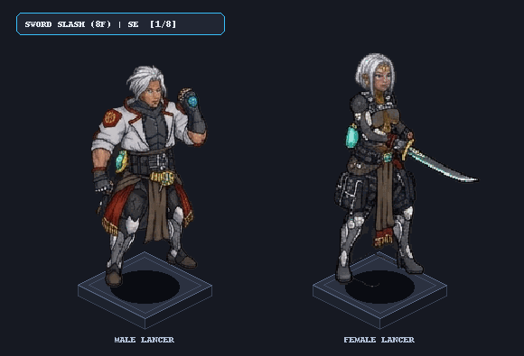
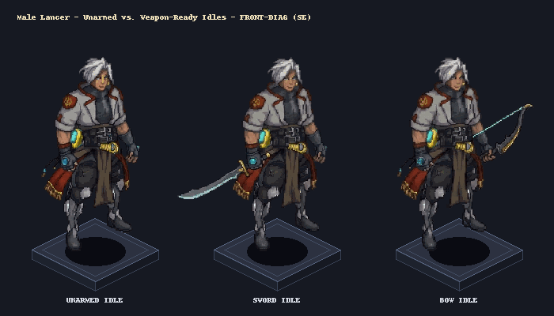
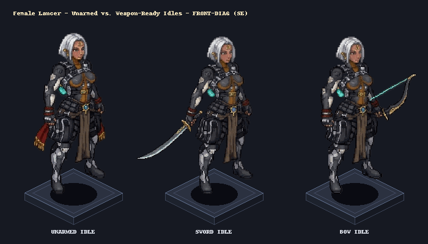
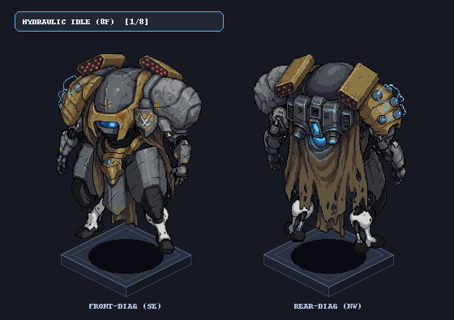
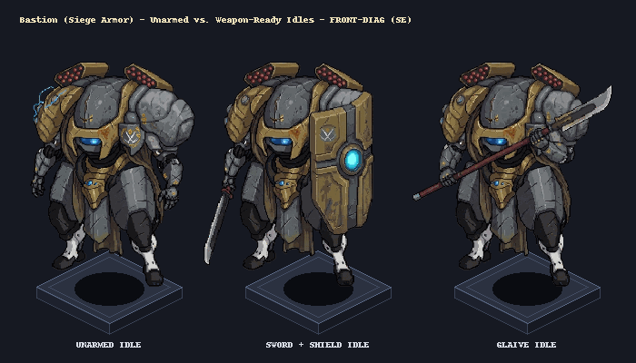
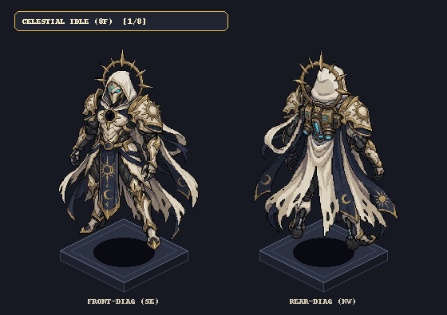
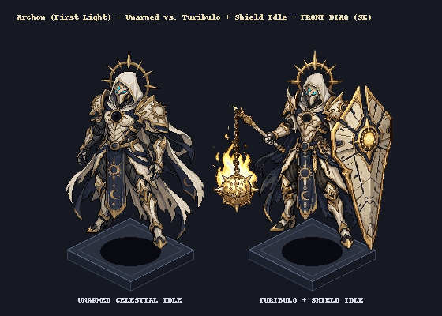

# Soverai — Unified Isometric Tactical RPG Sprite Library

All hi-bit modern isometric tactical RPG pixel art sprite packs (*Blasphemous* / *Owlboy* / *Triangle Strategy* style) for **Soverai**, consolidated into a single repository with uniform `256×340` cell grids, transparent RGBA PNGs, weapon-ready standing idles, animated GIFs, a machine-readable [`manifest.json`](manifest.json), and an interactive GitHub Pages previewer.

> **Unified Interactive Isometric Previewer (GitHub Pages):** https://caio-bress.github.io/soverai-sprites/  
> Per-class previewers: [Lancer](https://caio-bress.github.io/soverai-sprites/lancer/) · [Bastion](https://caio-bress.github.io/soverai-sprites/bastion/) · [Archon](https://caio-bress.github.io/soverai-sprites/archon/)

---

## Class Roster Overview

| Class | Order | Animations (8 frames each, native `SE` & `NW`) | Directory |
| :--- | :--- | :--- | :---: |
| **Male Lancer** | The Old Guild / Nômade | Idle (Unarmed), Idle (Sword), Idle (Bow), Walk, Run, Sword Slash, Bow Shot | [`lancer/`](lancer/) |
| **Female Lancer** | The Old Guild / Nômade | Idle (Unarmed), Idle (Sword), Idle (Bow), Walk, Run, Sword Slash, Bow Shot | [`lancer/`](lancer/) |
| **Bastion** | The Old Guild / Nômade (Siege Armor) | Idle (Unarmed), Idle (Sword+Shield), Idle (2H Glaive), Heavy Walk, Juggernaut Run, Sword+Shield Attack, Two-Handed Glaive Cleave | [`bastion/`](bastion/) |
| **Archon (First Light)** | The Old Faith | Celestial Idle (Unarmed), Idle (Turíbulo+Shield), Regal Walk, Celestial Run, Turíbulo + Solar Greatshield Attack, First Light Miracle Cast | [`archon/`](archon/) |

---

## Animated Showcases

### 1. Lancer Duo (The Old Guild / Nômade)

| Combat Showcase | Male Idles (Unarmed · Sword · Bow) | Female Idles (Unarmed · Sword · Bow) |
| :---: | :---: | :---: |
|  |  |  |

- Full Lancer catalog & sheets: [`lancer/README.md`](lancer/README.md)

### 2. Bastion (The Old Guild — Siege Armor)

| All 5 Core Actions (`SE` & `NW`) | Unarmed vs. Weapon-Ready Idles |
| :---: | :---: |
|  |  |

- Full Bastion catalog & sheets: [`bastion/README.md`](bastion/README.md)

### 3. Archon (The Old Faith — Path of the First Light · Gold)

| All 5 Core Actions (`SE` & `NW`) | Unarmed vs. Turíbulo + Solar Greatshield Idle |
| :---: | :---: |
|  |  |

- Full Archon catalog & sheets: [`archon/README.md`](archon/README.md)

---

## Engine Integration Spec

All classes share one consistent isometric grid specification (also indexed in [`manifest.json`](manifest.json)):

- **Cell Size:** `256 × 340` px (transparent RGBA PNG)
- **Horizontal Anchor:** Torso centered at `x = 128`
- **Ground Foot Anchor:** `y = 318` (Bastion & Archon) / `y = 320` (Lancers)
- **Frames per Animation:** `8` frames (`2048 × 340` for 1×8 strips, `2048 × 680` for 2×8 `SE`/`NW` sheets, `2048 × 1700` for 5×8 master sheets)
- **4-Way Isometric Directions:**
  - `SE` (Front-Right): native `se` sheet
  - `SW` (Front-Left): `flipX` of `se` sheet
  - `NW` (Rear-Left): native `nw` sheet
  - `NE` (Rear-Right): `flipX` of `nw` sheet

---

## Repository Structure

```text
soverai-sprites/
├── index.html                  # Unified All-Classes Interactive Isometric Previewer (GitHub Pages)
├── manifest.json               # Machine-readable sprite & GIF manifest for game engines
├── README.md                   # This catalog
├── tools/
│   └── rebuild_unified_previewer.py
├── lancer/                     # Male & Female Lancer sheets, weapon idles, GIFs, originals & tools
├── bastion/                    # Siege Armor Bastion sheets, weapon idles, GIFs, originals & tools
└── archon/                     # First Light Archon sheets, weapon idle, GIFs, originals & tools
```
