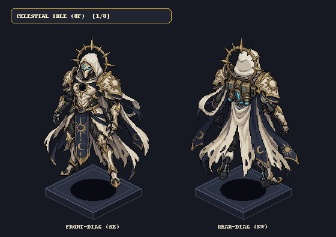
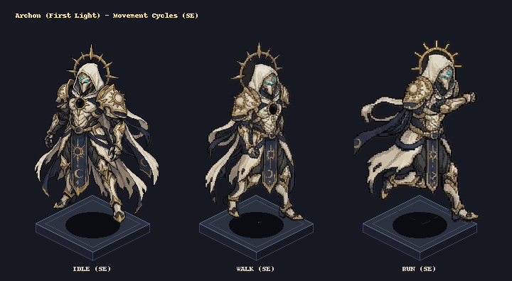
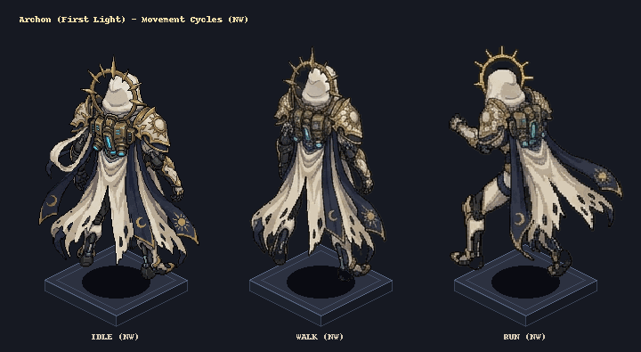
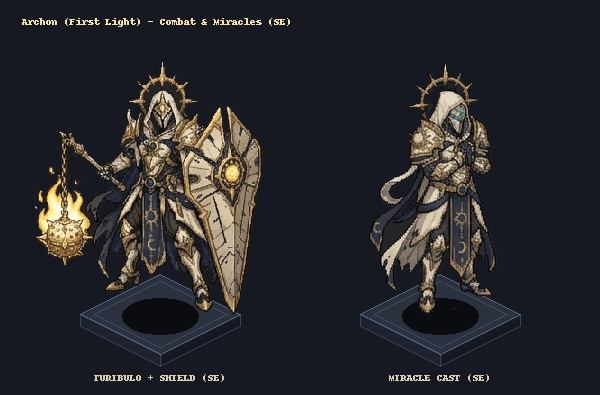
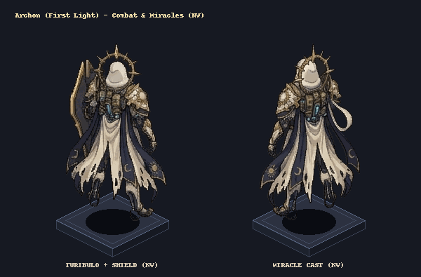
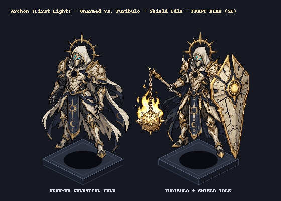

# Soverai — Archon (The Old Faith · First Light) Isometric Sprite Pack

Hi-bit modern isometric tactical RPG pixel art sprite pack (*Blasphemous* / *Owlboy* / *Triangle Strategy* style) for the **Archon** class (*Ordem: The Old Faith — Path of the First Light*: Ivory ceramic-plate exosuit, filigree gold sun/moon heraldry, floating spiked solar halo, tattered midnight-navy celestial cloak, and cyan optics/thrusters).

> **Interactive Isometric Previewer (GitHub Pages):** https://caio-bress.github.io/soverai-archon-sprites/

---

## Animated Showcase (All 5 Actions — SE & NW)



### Movement Cycles (Idle · Walk · Run)

| Front-Diagonal (SE) | Rear-Diagonal (NW) |
| :---: | :---: |
|  |  |

### Combat & Miracles (Turíbulo + Solar Greatshield · First Light Miracle Cast)

| Front-Diagonal (SE) | Rear-Diagonal (NW) |
| :---: | :---: |
|  |  |

---

## Individual Transparent Animated GIFs

| Animation | Front-Diagonal (`SE`) | Rear-Diagonal (`NW`) | Frames | Timing |
| :--- | :---: | :---: | :---: | :---: |
| **Celestial Idle (Breathing + Floating Halo)** | [`archon_se_idle.gif`](gifs/archon_se_idle.gif) | [`archon_nw_idle.gif`](gifs/archon_nw_idle.gif) | 8 | 140 ms |
| **Regal Walk (Unarmed)** | [`archon_se_walk.gif`](gifs/archon_se_walk.gif) | [`archon_nw_walk.gif`](gifs/archon_nw_walk.gif) | 8 | 100 ms |
| **Celestial Run / Sprint (Unarmed)** | [`archon_se_run.gif`](gifs/archon_se_run.gif) | [`archon_nw_run.gif`](gifs/archon_nw_run.gif) | 8 | 85 ms |
| **Turíbulo (Censer Flail) + Solar Greatshield** | [`archon_se_turibulo_shield.gif`](gifs/archon_se_turibulo_shield.gif) | [`archon_nw_turibulo_shield.gif`](gifs/archon_nw_turibulo_shield.gif) | 8 | 95 ms |
| **First Light Miracle Cast (Solar Judgement)** | [`archon_se_miracle_cast.gif`](gifs/archon_se_miracle_cast.gif) | [`archon_nw_miracle_cast.gif`](gifs/archon_nw_miracle_cast.gif) | 8 | 110 ms |

---

## Sprite Sheets (`256×340` per cell · Ground Anchor `y = 318`)

All sheets use transparent RGBA PNGs with uniform `256×340` cell grids, torso horizontally centered at `x = 128`, and feet anchored at `y = 318`. Mirror horizontally in-engine (`SW = flipX(SE)`, `NE = flipX(NW)`) for full 4-way isometric facings.

### Unified 5×8 Master Sheets (`2048×1700`)

- **Front-Diagonal (`SE`):** [`sprites/archon_isometric_se_5row_master.png`](sprites/archon_isometric_se_5row_master.png)
- **Rear-Diagonal (`NW`):** [`sprites/archon_isometric_nw_5row_master.png`](sprites/archon_isometric_nw_5row_master.png)

Row layout in both master sheets:
- **Row 0 (`y = 0..339`):** Celestial Idle (8f)
- **Row 1 (`y = 340..679`):** Regal Walk (8f)
- **Row 2 (`y = 680..1019`):** Celestial Run (8f)
- **Row 3 (`y = 1020..1359`):** Turíbulo (Censer Flail) + Solar Greatshield Attack (8f)
- **Row 4 (`y = 1360..1699`):** First Light Miracle Cast (8f)

### Separate Per-Action 2×8 Sheets (`2048×680`, Row 0 = `SE`, Row 1 = `NW`)

- **Celestial Idle:** [`sprites/archon_idle_sheet.png`](sprites/archon_idle_sheet.png)
- **Regal Walk:** [`sprites/archon_walk_sheet.png`](sprites/archon_walk_sheet.png)
- **Celestial Run:** [`sprites/archon_run_sheet.png`](sprites/archon_run_sheet.png)
- **Turíbulo + Solar Greatshield:** [`sprites/archon_turibulo_shield_sheet.png`](sprites/archon_turibulo_shield_sheet.png)
- **First Light Miracle Cast:** [`sprites/archon_miracle_cast_sheet.png`](sprites/archon_miracle_cast_sheet.png)

### Separate 1×8 Horizontal Strips (`2048×340`) & Individual Frames

- **1×8 Strips:** `sprites/archon_{se|nw}_{idle|walk|run|turibulo_shield|miracle_cast}_strip.png`
- **80 Individual Transparent Frames:** `sprites/archon/{se|nw}/{idle|walk|run|turibulo_shield|miracle_cast}_{0..7}.png`

---

## Repository Structure

```text
soverai-archon-sprites/
├── index.html                           # Standalone interactive isometric previewer (GitHub Pages)
├── archon_isometric_previewer.html      # Interactive HTML previewer copy
├── sprites/
│   ├── archon_isometric_se_5row_master.png
│   ├── archon_isometric_nw_5row_master.png
│   ├── archon_{idle|walk|run|turibulo_shield|miracle_cast}_sheet.png
│   ├── archon_{se|nw}_{action}_strip.png
│   └── archon/{se|nw}/{action}_{0..7}.png
├── gifs/
│   ├── archon_all_animations_showcase.gif
│   ├── archon_{se|nw}_{movement|combat}_showcase.gif
│   └── archon_{se|nw}_{action}.gif
├── originals/                           # Raw source renders
└── tools/
    ├── make_archon_guides.py            # Isometric pose guide generator
    ├── build_archon_pack.py             # Background cleanup, watershed slicing, normalization & GIF export
    └── rebuild_archon_previewer.py      # Base64 sprite embedder for interactive previewers
```
---

## Weapon-Ready Standing Idle (Turíbulo + Solar Greatshield — `SE` & `NW`)

In addition to the unarmed Celestial Breathing Idle, the Archon now includes a dedicated 8-frame standing **Turíbulo + Solar Greatshield Idle** with levitating spiked halo and flickering sacred censer flames:



- **Separate 2×8 Sheet (`2048×680`, `SE` top / `NW` bottom):** [`sprites/archon_idle_turibulo_shield_sheet.png`](sprites/archon_idle_turibulo_shield_sheet.png)
- **Transparent GIFs & 1×8 Strips:** [`gifs/archon_se_idle_turibulo_shield.gif`](gifs/archon_se_idle_turibulo_shield.gif) · [`gifs/archon_nw_idle_turibulo_shield.gif`](gifs/archon_nw_idle_turibulo_shield.gif) · `sprites/archon_{se|nw}_idle_turibulo_shield_strip.png`
- **Individual Frames:** `sprites/archon/{se|nw}/idle_turibulo_shield_{0..7}.png`
