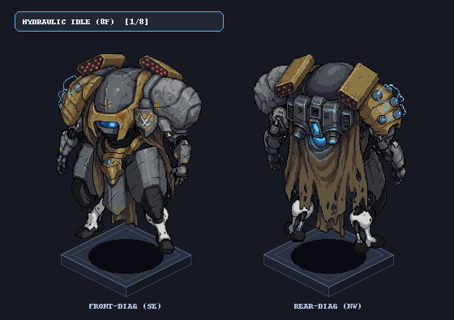
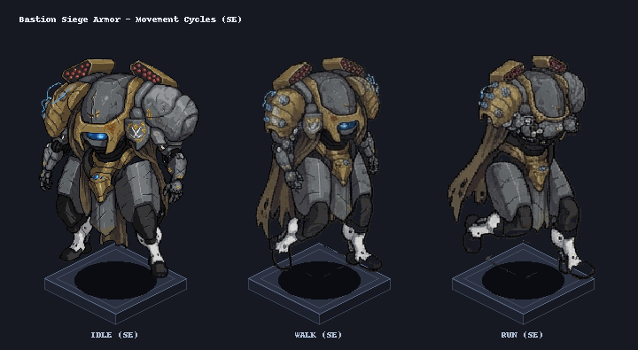
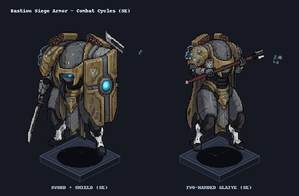
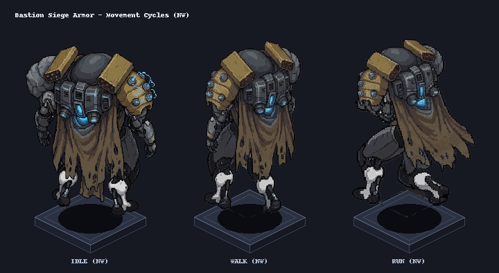
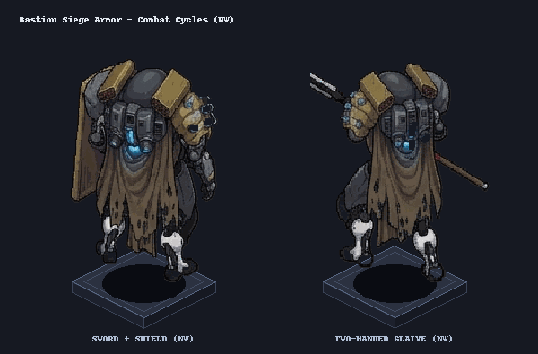
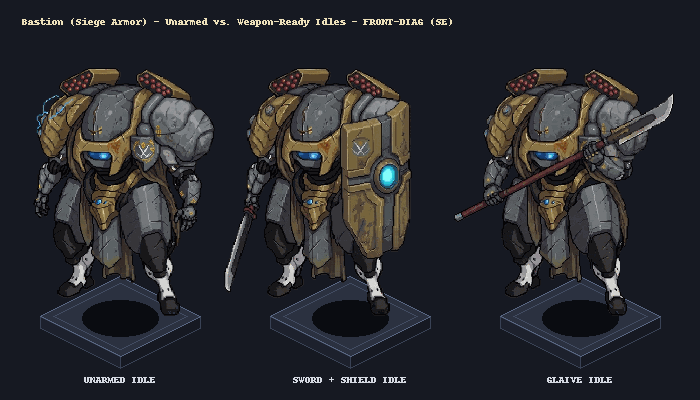

# Soverai — Bastion (The Old Guild / Nômade) 5×8 Isometric Siege Armor Pack

Hi-bit isometric pixel art character sprites, **animated GIFs**, and **5×8 master sprite sheets** (**Hydraulic Breathing Idle**, **Heavy Walk**, **Juggernaut Charge/Run**, **Sword + Heavy Siege Shield**, and **Two-Handed Glaive** across `SE`, `SW`, `NW`, and `NE`) for the **Bastion** (*A Velha Guilda* Siege Armor).

## Interactive Browser Previewer

- **GitHub Pages (Live):** https://caio-bress.github.io/soverai-bastion-sprites/
- **Local / Offline:** Open [`index.html`](./index.html) or [`bastion_isometric_previewer.html`](./bastion_isometric_previewer.html) directly in any desktop browser — both transparent 5×8 master sheets are embedded inside the HTML file.

---

## Animated GIF Showcases (`gifs/`)

### Full All-in-One Showcase (`SE` & `NW` Cycling All 5 Animations)

| Movement (`Idle` / `Walk` / `Charge`) | Combat (`Sword+Shield` & `2H Glaive`) |
| :---: | :---: |
|  |  |
|  |  |

### Individual Transparent Looping GIFs (`gifs/`)
| Direction | Hydraulic Idle | Heavy Walk | Juggernaut Run | Sword + Shield | Two-Handed Glaive |
| :--- | :--- | :--- | :--- | :--- | :--- |
| **`SE` (Front-Diag)** | [`idle`](./gifs/bastion_se_idle.gif) | [`walk`](./gifs/bastion_se_walk.gif) | [`run`](./gifs/bastion_se_run.gif) | [`sword_shield`](./gifs/bastion_se_sword_shield.gif) | [`glaive`](./gifs/bastion_se_glaive.gif) |
| **`NW` (Rear-Diag)** | [`idle`](./gifs/bastion_nw_idle.gif) | [`walk`](./gifs/bastion_nw_walk.gif) | [`run`](./gifs/bastion_nw_run.gif) | [`sword_shield`](./gifs/bastion_nw_sword_shield.gif) | [`glaive`](./gifs/bastion_nw_glaive.gif) |

---

## Sprite Sheets (`sprites/`, `256×340` per cell)

### 1. Unified 5×8 Master Sheets (`2048×1700` — Rows: `Idle`, `Walk`, `Run`, `Sword+Shield`, `Glaive`)
- [`sprites/bastion_isometric_se_5row_master.png`](./sprites/bastion_isometric_se_5row_master.png) — `SE` (flip for `SW`)
- [`sprites/bastion_isometric_nw_5row_master.png`](./sprites/bastion_isometric_nw_5row_master.png) — `NW` (flip for `NE`)

### 2. Separate Per-Animation Sheets (`2048×680` — Row 0: `SE`, Row 1: `NW`) & 1×8 Strips
- **Hydraulic Idle:** [`bastion_idle_sheet.png`](./sprites/bastion_idle_sheet.png) (`bastion_se_idle_strip.png`, `bastion_nw_idle_strip.png`)
- **Heavy Walk:** [`bastion_walk_sheet.png`](./sprites/bastion_walk_sheet.png) (`bastion_se_walk_strip.png`, `bastion_nw_walk_strip.png`)
- **Juggernaut Charge/Run:** [`bastion_run_sheet.png`](./sprites/bastion_run_sheet.png) (`bastion_se_run_strip.png`, `bastion_nw_run_strip.png`)
- **Sword + Heavy Siege Shield:** [`bastion_sword_shield_sheet.png`](./sprites/bastion_sword_shield_sheet.png) (`bastion_se_sword_shield_strip.png`, `bastion_nw_sword_shield_strip.png`)
- **Two-Handed Glaive:** [`bastion_glaive_sheet.png`](./sprites/bastion_glaive_sheet.png) (`bastion_se_glaive_strip.png`, `bastion_nw_glaive_strip.png`)

### 3. Individual Sliced & Stabilized Frames (`80` transparent `.png` frames)
- `sprites/bastion/se/` & `sprites/bastion/nw/` (`idle_0..7.png`, `walk_0..7.png`, `run_0..7.png`, `sword_shield_0..7.png`, `glaive_0..7.png`)
---

## Weapon-Ready Standing Idles (Sword + Shield & Two-Handed Glaive — `SE` & `NW`)

In addition to the unarmed hydraulic breathing idle, the Bastion now includes dedicated 8-frame standing **Weapon-Ready Idles** holding the Siege Broadsword + Reactor Riot Shield and the Two-Handed Siege Glaive:

- **Separate 2×8 Sheets (`2048×680`, `SE` top / `NW` bottom):**
  - [`sprites/bastion_idle_sword_shield_sheet.png`](sprites/bastion_idle_sword_shield_sheet.png)
  - [`sprites/bastion_idle_glaive_sheet.png`](sprites/bastion_idle_glaive_sheet.png)
- **Transparent GIFs & 1×8 Strips:** `gifs/bastion_{se|nw}_idle_{sword_shield|glaive}.gif` & `sprites/bastion_{se|nw}_idle_{sword_shield|glaive}_strip.png`
- **Individual Frames:** `sprites/bastion/{se|nw}/idle_{sword_shield|glaive}_{0..7}.png`
